# CYBERCLOCK

Custom cyberpunk firmware for the **GeekMagic SmallTV Ultra**: an ESP8266 desk clock with a 240×240 screen.
It replaces the stock firmware with twelve animated clock faces, live weather from Open-Meteo, night
dimming, and a web admin page. Flash it, and go back to stock, over Wi-Fi. No cable needed.

## Faces

| | Face | What it shows |
|---|---|---|
| 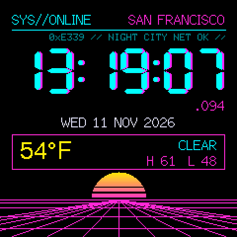 | **Netrunner** | Cyan `HH:MM:SS` with a magenta ghost and glitch slices, live milliseconds, a scrolling data ticker, a synthwave sun over a moving perspective grid. |
| 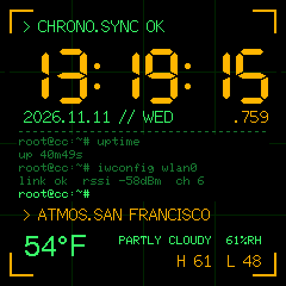 | **Terminal** | Amber `HH:MM:SS` on a green grid, and a shell pane where commands type out, "press enter" and print live values (uptime, Wi-Fi signal, weather, free memory) in a loop. |
| 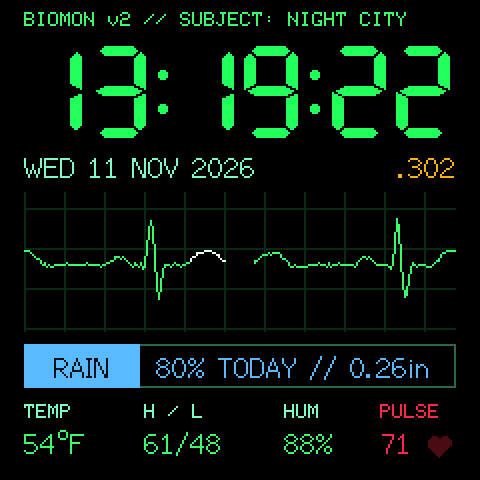 | **Vitals** | A hospital monitor: an ECG trace with a drifting heart rate, varied beats and the odd skipped beat, plus today's outlook (RAIN / DRY / SNOW / STORM, chance and total). |
| 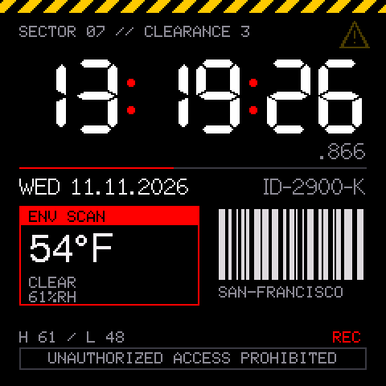 | **Corpo** | A corporate security screen: white `HH:MM:SS` with red colons, a minute progress rule, a barcode that reshuffles each minute, and scrolling hazard stripes. |
| 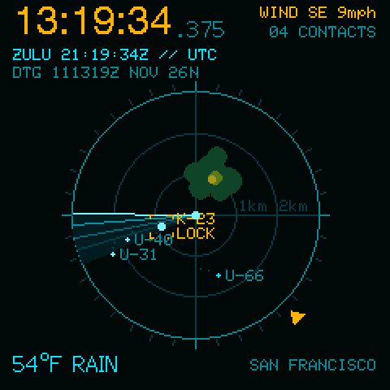 | **Radar** | A scope with drifting contacts and trails, a lock box and hostile blips. Rain clutter and the wind marker come from live weather. The time also shows as ZULU/UTC and a military date-time group. |
| 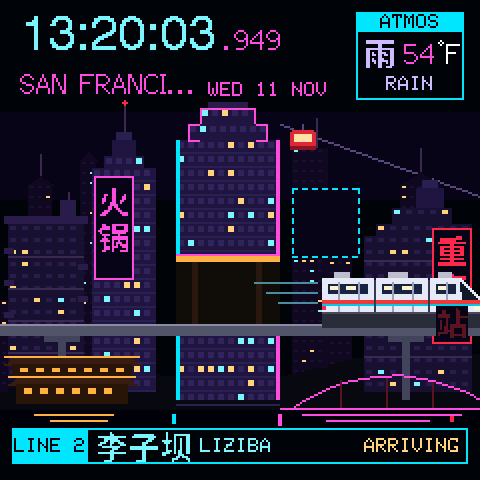 | **Chongqing** | A neon hillside skyline at night, with hotpot signs in Chinese, the Yangtze cable car and a bridge over the river. A monorail runs through Liziba station at the top of every minute, and the footer counts down to the next train. Rain and snow follow live weather. |
| 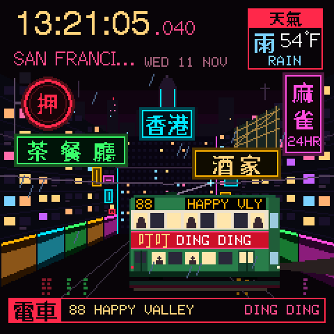 | **Hong Kong** | A neon street canyon with flickering signs in traditional Chinese and wet-street reflections. A "ding ding" tram to Happy Valley rolls through at the top of every minute, and taxis pass in between. Rain and snow follow live weather. |
| 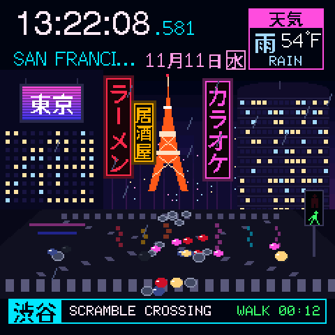 | **Shibuya** | The scramble crossing seen from above, under a big video screen, Japanese signs and Tokyo Tower. The crowd crosses on green for the first 20 seconds of each minute, with umbrellas out when it rains, then the cars take over. The footer counts down the walk signal. |
| 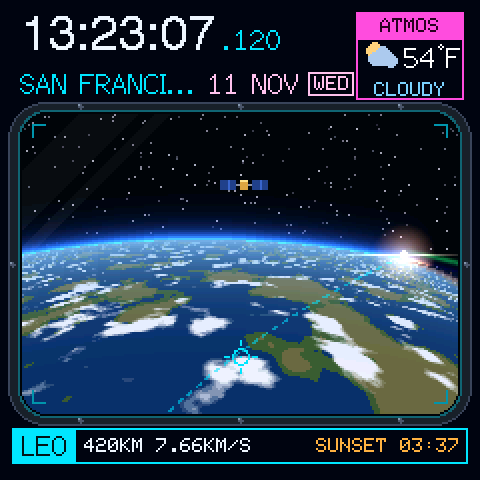 | **Orbit** | Earth through a space-station window. The day/night line is the real one for your city and time, with city lights on the night side, clouds that follow the weather, and a countdown to sunrise or sunset. A satellite passes at the top of every minute. |
| 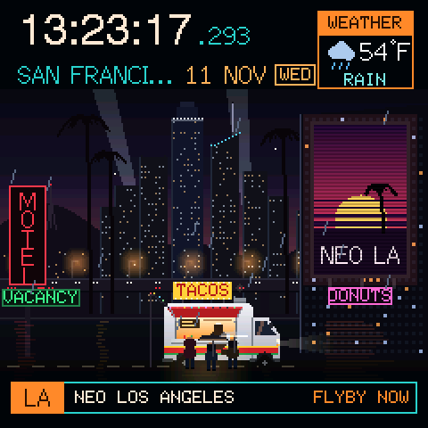 | **Neo LA** | Los Angeles on a smoggy night: searchlights over downtown, freeway traffic, palms, an ad blimp scrolling the temperature and time, a flickering motel sign and a taco truck with a late crowd. A flying car crosses at :15 and :45. Rain, snow, fog and lightning follow live weather. |
| 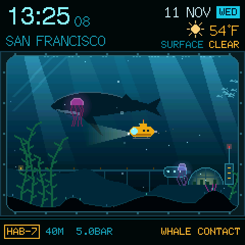 | **Abyss** | The window of a sea-floor habitat. Light shafts from the surface follow the weather and the real day and night over your city, jellyfish glow brighter after dark, and a sub patrols with its headlight. A whale passes at the top of every minute. |
| 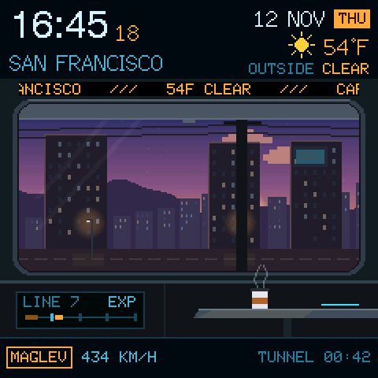 | **Maglev** | The view from a train window as a city slides past in layers. It follows the weather and the real day and night over your city, with neon signs lit from dusk to dawn and rain or snow streaking across the glass. The train enters a tunnel at the top of every minute and another train passes at :30. |

Every face shows local time with seconds, the date and the current weather.
Times shown before the clock has synced read `--:--`.

The screenshots come from the browser simulator, which runs the real faces on your computer:
run `pio run -e smalltv` once, then `sh sim/build.sh` and `./sim/cyberclock-sim`, and open `http://localhost:8240`.

## Features

- **Weather** from [Open-Meteo](https://open-meteo.com): no API key, refreshed every 15 minutes. Includes temperature, conditions, high/low, humidity, today's rain chance/total and wind.
- **Time** via NTP. The timezone and daylight saving follow the selected city automatically.
- **Admin page** at `http://<device-ip>/`: city search, °C/°F, face, brightness, night mode, firmware update.
- **Night mode**: dims the screen on a schedule (default 23:00–07:00 at 15 %; 0 % turns it off).
- **Wi-Fi setup hotspot**: if the clock can't join a network, it opens `CYBERCLOCK-SETUP` so you can pick one from your phone.
- **Over-the-air updates** at `/update`, including going back to the stock firmware.

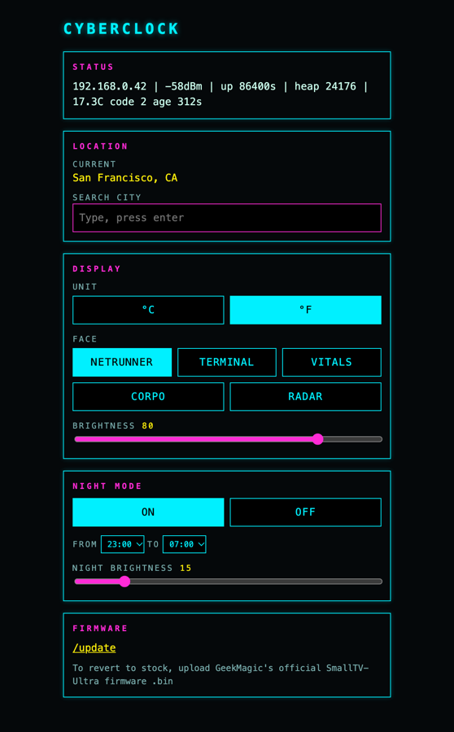

## Hardware

GeekMagic SmallTV **Ultra** (ESP8266, 4 MB flash, ST7789 240×240). Other GeekMagic models use different chips and pins,
so this firmware will not work on them.

| Signal | GPIO |
|---|---|
| SPI clock | 14 |
| SPI data (MOSI) | 13 |
| Display DC | 0 |
| Display reset | 2 |
| Backlight (PWM, active low) | 5 |

## Build

Requires [PlatformIO](https://platformio.org) (`pipx install platformio`).

```bash
pio test -e native    # unit tests for the logic (settings, weather parsing, formatting)
pio run -e smalltv    # builds .pio/build/smalltv/firmware.bin
```

Optional: to skip the setup hotspot, copy `secrets.ini.example` to `secrets.ini` and fill in your
Wi-Fi name and password. `secrets.ini` is git-ignored.

## Flash

1. **First time (from stock):** open `http://<device-ip>/update` on the stock firmware, choose
   `firmware.bin` under **Firmware**, click **Update**, and leave the device powered for about 30 seconds.
2. **Wi-Fi:** the clock tries the network saved on the chip. If that fails, the screen shows
   `CYBERCLOCK-SETUP`. Join that network from your phone, pick your Wi-Fi, and the clock shows its IP.
   The hotspot closes after 5 minutes with no one connected and the clock reboots to retry.
3. **Later updates:** upload a new `firmware.bin` at `http://<device-ip>/update`, or from the command line:

```bash
curl -F "firmware=@.pio/build/smalltv/firmware.bin" http://<device-ip>/update
```

**Back to stock:** download the official Ultra firmware from
[GeekMagicClock/smalltv-ultra](https://github.com/GeekMagicClock/smalltv-ultra) and upload it at `/update`.

If a flash ever leaves the clock unable to boot, recovery needs a USB-serial adapter
(hold GPIO0 low at power-up).

## API

| Method | Path | Notes |
|---|---|---|
| `GET` | `/api/config` | Current settings. |
| `POST` | `/api/config` | JSON body with any of: `city`, `lat`, `lon`, `unit` (`"C"`/`"F"`), `face` (0 Netrunner, 1 Terminal, 2 Vitals, 3 Corpo, 4 Radar, 5 Chongqing, 6 Hong Kong, 7 Shibuya, 8 Orbit, 9 Neo LA, 10 Abyss, 11 Maglev), `brightness`, `nightOn`, `nightStart`, `nightEnd`, `nightBrightness`. Invalid values keep the current setting. |
| `GET` | `/api/geocode?q=Tokyo` | City search (up to 5 matches). |
| `GET` | `/api/status` | IP, Wi-Fi signal, uptime, free memory, last weather. |

```bash
curl -X POST -d '{"face":4,"unit":"C"}' http://<device-ip>/api/config
```

The admin page and API have no password, the same as the stock firmware. Anyone on your network can change settings or upload firmware.

## Credits

- Weather data by [Open-Meteo.com](https://open-meteo.com) (CC BY 4.0).
- Display: [TFT_eSPI](https://github.com/Bodmer/TFT_eSPI). Wi-Fi setup: [WiFiManager](https://github.com/tzapu/WiFiManager). JSON: [ArduinoJson](https://arduinojson.org).
- Not affiliated with or endorsed by GeekMagic.

## License

[Apache 2.0](LICENSE). Provided as is, without warranty. Flashing custom firmware is at your own risk.
